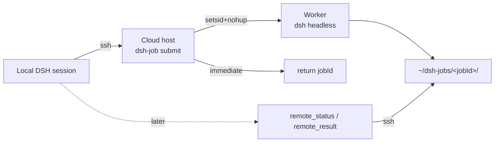

# dsh-remote-dispatch — User & Operator Guide

A task-oriented walkthrough. If you want exact signatures and error codes, read
[API.md](./API.md).

---

## 0. What this plugin does (in one paragraph)

It lets the local DSH harness hand a prompt to a **DSH installed on a cloud server**,
over SSH, and then *walk away*. The cloud side runs `dsh --profile headless` under
`setsid nohup`, detaching it from the SSH session, so closing the laptop, losing Wi-Fi,
or rebooting the local machine has no effect on the job
(`remote/dsh-job.sh:61-64`, `src/tools.js:89-92`). You reconnect later, ask
`remote_status`, and pull the answer with `remote_result`.



---

## 1. First-time setup

### 1.1 Prerequisites checklist

| # | Where | Requirement | How to check |
|---|---|---|---|
| 1 | Local | The plugin bundle is enabled in the profile (`web` and/or `headless`) | restart DSH, look for the 云端派发 settings section |
| 2 | Local | OpenSSH client on `PATH` (the plugin shells out to `ssh`) | `ssh -V` |
| 3 | Local (Windows only) | `csc.exe` **if the credential uses a password** | `%WINDIR%\Microsoft.NET\Framework64\v4.0.30319\csc.exe` must exist (`src/ssh.js:59-68`) |
| 4 | Local | `tar` on `PATH` if you plan to use `localDir` | Windows 10+ ships it as `C:\Windows\System32\tar.exe` (`src/service.js:418`) |
| 5 | Cloud | `node` and `dsh` reachable on a **non-interactive** SSH `PATH` | `ssh host 'command -v node dsh'` |
| 6 | Cloud | `headless` profile present | `ssh host 'dsh --profile headless --version'` |
| 7 | Cloud | `~/.dsh/.env.headless` with the model key | used by the worker via `KEY_ENV_FILE` (`remote/dsh-job.sh:23, 85-87`) |
| 8 | Cloud | `dsh-job` runner installed | `ssh host 'command -v dsh-job'` |
| 9 | Local | An **SSH** record in the DSH credential store | `remote_devices({action:"sshCredentials"})` |

> **Why #5 matters most.** nvm-installed Node is invisible to non-interactive SSH.
> The standard fix is to symlink both binaries into `/usr/local/bin`:
>
> ```bash
> sudo ln -sf ~/.nvm/versions/node/vXX/bin/node /usr/local/bin/node
> sudo ln -sf ~/.nvm/versions/node/vXX/bin/dsh  /usr/local/bin/dsh
> ```
>
> The worker also prepends `dirname "$DSH_BIN"` to `PATH` itself, so a symlinked `dsh`
> plus the documented `DSH_BIN` is enough for the *runner* — but `probe`'s
> `command -v node` still has to succeed for `ready:true` (`src/service.js:362-380`).

### 1.2 Install the runner on the cloud host

`remote/dsh-job.sh` contains three deploy-time placeholders. **Replace them before
installing** — leaving them in place produces a silently broken runner
(see API.md §6).

```bash
# On your workstation: prepare a host-specific copy
sed -e 's#__JOB_ROOT__#/root/dsh-jobs#' \
    -e 's#__DSH_BIN__#/usr/local/bin/dsh#' \
    -e 's#__KEY_ENV__#/root/.dsh/.env.headless#' \
    remote/dsh-job.sh > /tmp/dsh-job.sh

# Copy and install on the server
scp /tmp/dsh-job.sh root@<host>:/tmp/dsh-job.sh
ssh root@<host> 'sudo install -m 755 /tmp/dsh-job.sh /usr/local/bin/dsh-job && dsh-job list'
```

`DSH_JOB_ROOT` must match the directory the plugin inspects — the plugin hard-codes
`$HOME/dsh-jobs` (`src/service.js:591, 498, 627, 643`). Use `$HOME/dsh-jobs`.

### 1.3 Bind the SSH server as a "device"

A *device* is a binding between a name you type into tools and a credential id. The
password or key **never leaves the credential store** (`src/devices.js:1-12`).

**Option A — the GUI (recommended)**

1. *Settings → 云端派发*.
2. Under **用 SSH 关联新设备**, pick an SSH credential from the dropdown. Options show
   `name — user@host:port（密码|私钥）` (`client.js:535-537`).
3. Fill in **显示名** (e.g. `我的云主机 A`). Optionally set **设备名**; leaving it blank
   means the device name is derived from the display name
   (`client.js:648-651`, `src/devices.js:127`).
4. Press **绑定设备**.
5. Press **检测** on the new row. Expect the tag **就绪**.
   The mapping is (`client.js:580-584`):

   | Tag | Condition |
   |---|---|
   | 就绪 (green) | `reachable && ready` |
   | 缺运行时 (red) | `reachable` but `node`/`dsh` missing |
   | 不可达 (red) | `reachable === false` |

6. Press **设为默认** if this should be the implicit host.

**Option B — via the agent / tool**

```jsonc
remote_devices({ "action": "sshCredentials" })
// → { credentials: [ { id: "ssh-xxxxxxxxxxxx", name: "阿里云2H2C",
//                       host: "203.0.113.10", port: 22, username: "root",
//                       authMethod: "password", note: "" } ] }

remote_devices({
  "action": "bind",
  "name": "aliyun",            // becomes the `host:` value; lowercased, [^a-z0-9._-] → '-'
  "label": "我的云主机 A",
  "credentialId": "ssh-xxxxxxxxxxxx"
})

remote_hosts({ "host": "aliyun" })   // verify
```

> ⚠ **`bind` with an explicit `name` does not make the device default**
> (`src/tools.js:241`: `makeDefault: args.name ? undefined : true`). Follow up with
> `remote_devices({action:"setDefault", name:"aliyun"})` if needed.

**Option C — forget devices, use `cordis.patch.yml`**

If no `devices.json` exists yet, the registry seeds itself from `settings.hosts`
(`src/devices.js:55-76`). That makes the config file a valid cold-start path — but the
moment `devices.json` exists, **config changes stop taking effect**, because the
seeded/loaded document is cached and persisted (`src/devices.js:46-51`).

### 1.4 Verify end to end

```jsonc
remote_hosts({ "probe": false })   // is the device name registered at all?
remote_hosts({ "host": "aliyun" }) // deep check
remote_list({ "host": "aliyun" })  // requires dsh-job to be installed
```

A healthy `remote_hosts` entry looks like:

```json
{ "host": "aliyun", "label": "我的云主机 A", "hostname": "iZbp1…",
  "ssh": "root@203.0.113.10:22", "reachable": true,
  "node": "/usr/local/bin/node", "dsh": "/usr/local/bin/dsh",
  "runner": "/usr/local/bin/dsh-job", "home": "/root",
  "ready": true, "runnerInstalled": true, "warnings": [] }
```

---

## 2. Dispatch a long-running job before going offline

### 2.1 The text-only recipe (agent)

```jsonc
remote_dispatch({
  "task": "把 docs/ 下所有 Markdown 的标题层级规范化，然后生成 docs/INDEX.md；最后列出改了哪些文件。",
  "host": "aliyun",
  "project": "docs-cleanup"
})
// → { "jobId": "docs-cleanup-1110-200651", "host": "aliyun",
//     "ssh": "root@203.0.113.10:22", "project": "docs-cleanup",
//     "remoteRoot": "~/dsh-work/docs-cleanup", "notes": [],
//     "message": "docs-cleanup-1110-200651 已在 aliyun 上开始执行…" }
```

**Save the `jobId`.** It is the only handle you need later, and
`remote_list` can recover it if you lose it (`src/service.js:653-670`).

### 2.2 With a local project uploaded first

```jsonc
remote_dispatch({
  "task": "跑 pytest，修复失败用例，不要改测试断言。",
  "localDir": "C:/Users/you/projects/mytool",  // absolute path
  "project": "mytool"
})
```

What happens, in order (`src/service.js:466-491`):

1. `tar -czf payload.tar.gz --exclude <…> -C <localDir> .` (system `tar`, 300 s budget).
   Excluded names: `.git`, `node_modules`, `.venv`, `venv`, `__pycache__`, `.next`,
   `dist`, `build`, `.dsh`, `dsh-jobs`, `.cache`, `.DS_Store`, `target`,
   `.pytest_cache`, `.idea`, `.vscode` (`src/service.js:22-25`).
   These are matched **by basename at any depth**, so a `src/build/` directory is also
   skipped.
2. Size check against `maxUploadMb` (default 200 MB) — over the limit throws
   `upload-too-large` **before any bytes are sent** (`src/service.js:471-473`).
3. Upload to `/tmp/_dshpush-<jobId>.tar.gz` in 256 KiB chunks.
4. `mkdir -p ~/dsh-work/<project> && tar -xzf … -C <remoteRoot> --no-same-owner`,
   then delete the tarball. Success is confirmed by the sentinel `UPLOAD_OK`
   (`src/service.js:478-486`).
5. The archive is **overlaid** on the existing directory — it is not cleaned first.
   Stale files from an earlier upload survive.

> The cloud copy is a snapshot. There is **no sync back**: edits made on the cloud are
> not pulled into your local directory.

### 2.3 With the composer button

Type the task in the composer, click **推送 云**, choose a device, optionally type a
project name and a local directory, then **推送到云端**. The progress bar walks
`打包 → 上传 → 解包 → 提交` (`client.js:217-222`) and the final panel shows the job id
and `remoteRoot`.

> The button pushes the **draft text**, not the conversation history
> (`client.js:279-286` passes only `task`). The cloud agent starts from the prompt
> alone; it does not see your local chat.

### 2.4 Choosing the right call before you disconnect

| You are about to… | Use |
|---|---|
| Close the laptop / lose network | `remote_dispatch`, then stop. **Do not** use `remote_wait`. |
| Stay online but want the answer inline | `remote_wait` with an explicit `timeoutSeconds` |
| Check whether it finished *right now* | `remote_status` |

`remote_wait` holds an SSH connection open for the whole duration; its own description
tells you not to use it when you are leaving (`src/tools.js:141-143`).
Interrupting a `remote_wait` (`Esc` / Ctrl-C) does **not** kill the job — the job is
detached at the OS level.

### 2.5 Multiple dispatches queue, they don't parallelise

The worker takes a host-wide `flock` before starting (`remote/dsh-job.sh:72-74`).
Every job on the same host runs **strictly serially**, in submission order. A second
`remote_dispatch` returns immediately with a job id, but `remote_status` will show
`queued` until the first job finishes.

Consequences:

- Do not measure "it hasn't started" as a failure. `queued` is expected.
- A 5-minute job dispatched behind a 3-hour job waits 3 hours.
- Two **different hosts** run fully in parallel.

---

## 3. Retrieve results after reconnecting

```mermaid
sequenceDiagram
    autonumber
    participant U as You (local DSH)
    participant R as RPC / tools
    participant S as SSH transport<br/>src/ssh.js
    participant H as Cloud host<br/>dsh-job + dsh headless
    participant D as ~/dsh-jobs/&lt;jobId&gt;/

    Note over U,H: ── Phase 1: dispatch (before going offline) ──
    U->>R: remote_dispatch({task, host, project, localDir?})
    R->>S: pack tar.gz (system tar, excludes)
    S->>H: cat > /tmp/_dshpush-&lt;jobId&gt;.tar.gz  (256 KiB chunks)
    S->>H: tar -xzf → ~/dsh-work/&lt;project&gt;  ⇒ UPLOAD_OK
    S->>H: cat > /tmp/_dshtask-&lt;jobId&gt;.md  ⇒ TASK_OK
    S->>H: dsh-job submit &lt;jobId&gt; &lt;workdir&gt; &lt;taskfile&gt; [--session &lt;sid&gt;]
    H->>D: mkdir, write task.md, status=queued, meta.json
    H-->>S: submitted: &lt;jobId&gt; (workdir=…)
    H->>H: setsid nohup __worker  (detached!)  flock → status=running
    S-->>R: {code:0}
    R-->>U: {jobId, host, remoteRoot, notes, message}
    Note over U,H: ══ local machine can sleep / lose network now ══
    H->>D: dsh --json → events.jsonl, err.log
    H->>D: extract final text → result.md ; status=done|failed

    Note over U,H: ── Phase 2: poll (after reconnecting) ──
    U->>R: remote_status({jobId, host})
    R->>S: ssh "cat status; cat pid; cat meta.json; wc -c result.md"
    S->>H: exec
    H->>D: read
    D-->>H: status / pid / meta / sizes
    H-->>S: STATE=done PID=18231 META={…} RESULT_BYTES=1834
    S-->>R: {code, stdout}
    R-->>U: {state:"done", finished:true, resultBytes:1834, …}

    Note over U,H: ── Phase 3: result ──
    U->>R: remote_result({jobId, host})
    R->>S: ssh "cat ~/dsh-jobs/&lt;jobId&gt;/result.md"
    S->>H: exec
    H->>D: read
    D-->>H: final answer text
    H-->>S: text + __RC=0
    S-->>R: {code:0, stdout}
    R-->>U: {jobId, host, text:"修复了 3 个失败用例…"}
```

### 3.1 The three-step poll

```jsonc
remote_status({ "jobId": "mytool-1110-200651" })
// → { "state": "done", "finished": true, "pid": "18231",
//     "resultBytes": 1834, "logLines": 14, "session": "ses_abc123",
//     "workdir": "~/dsh-work/mytool",
//     "submittedAt": "2026-11-10T20:06:51+08:00" }

remote_result({ "jobId": "mytool-1110-200651" })
// → { "text": "修复了 3 个失败用例…" }
```

`remote_status` on a host without a records directory throws **`job-not-found`**.

If you have forgotten the id:

```jsonc
remote_list({ "host": "aliyun" })
// → { "host":"aliyun", "count": 2, "jobs": [ {jobId, state, submittedAt}, … ] }
```

### 3.2 Reading a `result` that is not there yet

`remote_result` returns `result-empty` — *"任务 &lt;jobId&gt; 还没有结果（可能仍在运行）"* —
whenever `result.md` is missing or blank (`src/service.js:632-634`). That is the normal
answer while the job is `queued` or `running`. Cross-check with `remote_status`.

### 3.3 Result quality: `done` ≠ success

| `state` | What the runner actually observed |
|---|---|
| `done` | `dsh` exited with code 0 (`remote/dsh-job.sh:143-145`) |
| `failed` | `dsh` exited non-zero (`:146-148`) |

A task whose agent gave up gracefully still exits 0 and shows `done`. Read the text;
when the text looks like a refusal or a summary of failure, the job "succeeded" at the
CLI level only.

---

## 4. Continue a previous session

`continueSession` replays the cloud session so the model remembers the earlier work.

```jsonc
remote_dispatch({
  "task": "按 ARCH.md 里的第 3 点开始重构，保持公开 API 不变",
  "project": "mytool",              // ⚠ only affects the workdir, see below
  "host": "aliyun",
  "continueSession": "mytool-1110-200651"
})
// → { …, "session": "ses_abc123", "notes": ["续跑 session ses_abc123"] }
```

**How it works**

1. The dispatcher `cat`s `~/dsh-jobs/<continueSession>/meta.json` and greps for
   `"session"\s*:\s*"([^"]+)"` (`src/service.js:497-500`).
2. If found, `dsh-job submit … --session <sid>` is used, and the worker passes
   `--session-id <sid>` to `dsh` (`remote/dsh-job.sh:93-99`).
3. If not found, the job runs as a **new session** and the response carries the note
   `未找到 <id> 的 session，按新任务执行` (`src/service.js:503-505`). This is not an error.

**Gotchas**

- `continueSession` is **not sanitised** (`src/service.js:498`), unlike `jobId`
  (`:452`). If the original job used a custom id containing characters that get
  rewritten, type the *rewritten* id.
- `project` is **independent** of `continueSession`. The new job's cwd is
  `~/dsh-work/<project>`; if you omit `project` it defaults to `default`, so a
  continuation can end up running in a different directory from the original job
  while sharing its conversation. **Pass the same `project`** (or the same
  `localDir`).
- The session lives in the cloud DSH's session store. Deleting it (`dsh` cleanup,
  profile reset) makes continuations fall back to "new task".
- Continuation works even if the previous job `failed` or was `cancelled` — the runner
  writes the session id into `meta.json` after the run finishes
  (`remote/dsh-job.sh:102-111`), *before* the status is set.

---

## 5. Run on a non-default host

Three ways, in increasing precedence:

1. **Config default** — `defaultHost` in `cordis.patch.yml` seeds
   `devices.json.defaultDevice` on first load (`src/devices.js:57-60, 75`).
2. **Persisted default** — `remote_devices({action:"setDefault", name:"tencent"})` or
   the **设为默认** button.
3. **Per call** — pass `host:` to any tool:

   ```jsonc
   remote_dispatch({ "task": "…", "host": "tencent" })
   remote_status({ "jobId": "…", "host": "tencent" })
   ```

⚠ **Every follow-up call must repeat `host`.** `remote_status`, `remote_result`,
`remote_logs`, `remote_cancel`, `remote_wait` all fall back to the *default* device
when `host` is omitted (`src/service.js:132-136`, `src/tools.js:34-37`). A job
dispatched to `tencent` and then queried without `host` will resolve to `aliyun` and
report `job-not-found`.

`remote_hosts({probe:false})` returns only `{host, label, credentialId}` — it tells you
*which names exist* without paying for an SSH round-trip, which is handy when you are
unsure whether `tencent` is bound (`src/tools.js:71-75`).

Hosts are fully independent: separate job queues, separate `~/dsh-jobs`, separate
credential ids.

---

## 6. Troubleshoot a failed job

Work down this list — it matches the order the evidence is produced.

### 6.1 Step 1 — is the state even `failed`?

```jsonc
remote_status({ "jobId": "mytool-1110-200651" })
```

| You see | Meaning | Go to |
|---|---|---|
| `queued` for a long time | Waiting for the host lock behind another job | §6.6 |
| `running` but no progress for hours | Model is working, or wedged | `remote_logs` |
| `failed` | `dsh` exited non-zero | §6.2 |
| `done` but empty result | `dsh` exited 0 with no final event | §6.7 |
| `job-not-found` | Wrong host, or wrong jobId, or job dir removed | §6.5 |

### 6.2 Step 2 — read the run log

```jsonc
remote_logs({ "jobId": "mytool-1110-200651", "lines": 100 })
```

The returned `log` is literally two sections (`src/service.js:645-648`):

```
--- run.log ---
[2026-11-10 20:06:52] === start mytool-1110-200651 (wd=~/dsh-work/mytool session=<new>) ===
--- dsh exit rc=1 ---
Error: MISSING_CREDENTIAL: no API key found
--- stderr ---
Error: MISSING_CREDENTIAL: no API key found
```

Anatomy of `run.log`:

| Line | Written by |
|---|---|
| `[ts] === start <id> (wd=<wd> session=<sid or \<new\>>) ===` | worker, right after acquiring the lock (`remote/dsh-job.sh:82`) |
| `--- dsh exit rc=<n> ---` | worker, after `dsh` returns (`:138`) |
| last 40 lines of `err.log` copied in | worker (`:139`) |
| `[ts] === done <id> ===` / `=== failed <id> rc=<n> ===` | worker (`:145`, `:148`) |
| `[ts] job <id> cancelled before start` | worker noticed a pre-emptive cancel (`:77`) |
| `[ts] === job <id> cancelled at end ===` | cancel arrived mid-run (`:142`) |

`err.log` is `dsh`'s own stderr and is **truncated on every run**
(`> "$d/err.log"`, `:100`); `run.log` is **appended to** across retries
(`>> "$d/run.log"`, `:63`).

### 6.3 Step 3 — classify the failure

| Log signature | Root cause | Fix |
|---|---|---|
| `Error: MISSING_CREDENTIAL…` or an auth error from `dsh` | `KEY_ENV_FILE` missing/wrong, or the API key was rotated | fix `~/.dsh/.env.headless` on the host |
| `dsh: command not found` / `No such file or directory` on the dsh line | `DSH_BIN` placeholder not replaced, or nvm PATH issue | replace the placeholder, symlink `node`/`dsh` |
| `ERROR: job already exists: <id>` (surfaced as `submit-failed`) | Same project + same second, or a reused custom `jobId` | wait a second, or pass a distinct `jobId` |
| `submit-failed: … dsh-job: command not found` | Runner not installed on this host | install `dsh-job.sh` (§1.2) |
| `rc=124`, `Killed`, `signal: terminated` | Wall-clock/`OOM` kill on the host | split the task; add swap; check `dmesg` |
| `upload-failed: 解包失败…` | Disk full under `$HOME`, or a corrupt archive | `df -h`, clean `~/dsh-jobs` |
| `timeout: 命令超时（120s）：ssh` | Local `ssh` hit `commandTimeoutMs` | raise `commandTimeoutMs` (max 600 000) |
| `askpass-unavailable` | Windows password auth without `csc.exe` | use a key credential |
| `no-home` | Remote `$HOME` empty (odd shell / restricted account) | use a normal login user |

### 6.4 Step 4 — inspect on the host directly

When tool output is not enough, this is what the plugin itself runs — reproduce it
verbatim over SSH:

```bash
ssh root@<host>

# Everything the plugin reads for a status call
d=/root/dsh-jobs/mytool-1110-200651
cat $d/status; cat $d/pid; cat $d/meta.json
wc -c < $d/result.md; wc -l < $d/run.log

# The raw event stream (this is the ground truth)
head -1  $d/events.jsonl          # → contains "sessionId":"ses_…"
grep '"type":"final"' $d/events.jsonl
tail -50 $d/err.log
```

The first line of `events.jsonl` is where the session id comes from
(`remote/dsh-job.sh:104`); the last `{"type":"final"}` event is where `result.md`
comes from (`:114-136`). If `result.md` is empty but `events.jsonl` is full, the
extraction step is at fault — most often because `python3` is absent and the `sed`
fallback could not match the JSON (escaped quotes in the text will defeat it).

### 6.5 `job-not-found` when you are sure it ran

`job-not-found` is raised purely on "the directory `$HOME/dsh-jobs/<jobId>` does not
exist" (`src/service.js:593, 600-602`). Check:

1. **`host` omitted** → it resolved to the default device, not the one you used.
2. **`DSH_JOB_ROOT` on the host is not `$HOME/dsh-jobs`** → the plugin looks in
   `$HOME/dsh-jobs` unconditionally.
3. The directory was cleaned up (`rm -rf` of old jobs).
4. The jobId casing: job ids are case-sensitive on Linux.

### 6.6 `queued` forever

The worker holds `flock` on `$DSH_JOB_ROOT/.queue.lock` for the entire run
(`remote/dsh-job.sh:72-74`). Diagnose with:

```bash
ssh root@<host> 'fuser -v /root/dsh-jobs/.queue.lock; ps -eo pid,etime,cmd | grep -c "dsh-job\|dsh --profile"'
```

Cancel the blocking job with `remote_cancel({jobId:"<blocker>"})`. Cancelling a job
that never started is enough — the worker checks the status before doing anything
(`:76-78`).

> A `flock` held by a *crashed* worker is released by the kernel when the process dies,
> so a hard reboot of the host also clears the queue.

### 6.7 `done` but empty result

`state=done` only requires `rc == 0`. `result.md` is produced by extracting a
`{"type":"final"}` event (`remote/dsh-job.sh:114-136`). If `dsh` printed nothing on the
final line — a config error that still exits 0, or an interrupted stream — `result.md`
stays empty and `remote_result` answers `result-empty`. Read `events.jsonl` and
`run.log`; the answer is usually visible there even when `result.md` is blank.

### 6.8 Connection-level failures

`ssh` is invoked per command with `ServerAliveInterval=15`, `ServerAliveCountMax=4`
(`src/ssh.js:192-193`), so a dead link is detected in roughly 60 s. Local failures are
`timeout`, `spawn-failed`; remote non-zero exits usually surface as
`submit-failed`/`list-failed` with the host's stderr embedded.

---

## 7. Cleanup

### 7.1 Cloud disk

Nothing is auto-pruned. Growth is: one directory per job under `~/dsh-jobs`, plus one
persistent working tree per project under `~/dsh-work`.

```bash
# Inspect first
ssh root@<host> 'du -sh ~/dsh-jobs ~/dsh-work; du -sh ~/dsh-jobs/* | sort -h | tail -20'

# Delete finished job records older than 14 days (status file is the authority)
ssh root@<host> '
  cd ~/dsh-jobs 2>/dev/null || exit 0
  for d in */; do
    id="${d%/}"
    st=$(cat "$id/status" 2>/dev/null)
    case "$st" in
      done|failed|cancelled)
        [ -n "$(find "$id" -maxdepth 0 -mtime +14 -print -quit)" ] && rm -rf -- "$id" ;;
    esac
  done
  rm -f .queue.lock 2>/dev/null || true   # optional: only when nothing is running
'

# Remove a stale project working tree (uploaded code + build artifacts)
ssh root@<host> 'rm -rf ~/dsh-work/docs-cleanup'
```

Rules of thumb:

- **Never** `rm -rf ~/dsh-jobs` while a job runs — the worker's `PWD`-relative appends
  will fail and the job will end up `failed` with a confusing `rc`.
- Deleting a job directory makes `remote_status` answer `job-not-found` **permanently**;
  the id can never be resurrected, only re-dispatched.
- `~/dsh-work/<project>` is **not** cleaned by deleting jobs; a re-dispatch with the
  same project overlays onto whatever is left.
- Leftover temp files to sweep: `/tmp/_dshpush-*.tar.gz` and `/tmp/_dshtask-*.md`
  (the task file is only removed after a successful submit, `src/service.js:518`).
- Compress large `events.jsonl` before archiving; it is the biggest file per job.

### 7.2 Unbind a device

`remote_devices({action:"unbind", name:"tencent"})` → `{removed:"tencent",
defaultDevice:"aliyun"}`. Only the binding is deleted; the SSH credential stays in the
credential store (`src/devices.js:151-164`). The remote files are untouched.

Re-binding later with the same name restores access, because the job directory is
keyed by host `$HOME` and job id only.

### 7.3 Local cleanup

```
<DSH_HOME>/storages/dsh-remote-dispatch/devices.json   # delete to re-seed from config
<DSH_HOME>/storages/dsh-remote-dispatch/askpass.*      # safe to delete; regenerated
```

Deleting `devices.json` while the plugin is running has no effect until DSH restarts,
because the document is cached in memory (`src/devices.js:47`).

### 7.4 Rotate the model key

Update `~/.dsh/.env.headless` on **every** host. A stale key does not fail fast — the
job reaches `running`, then exits non-zero with `MISSING_CREDENTIAL` or an auth error in
`err.log` (`remote/dsh-job.sh:85-87`).

---

## 8. Quick reference

| I want to… | Call |
|---|---|
| see which hosts exist, without SSH | `remote_hosts({probe:false})` |
| verify a host can run jobs | `remote_hosts({host:"aliyun"})` → `ready` & `runnerInstalled` |
| bind a server | `remote_devices({action:"bind", name, label, credentialId})` |
| list bindable SSH credentials | `remote_devices({action:"sshCredentials"})` |
| make a host the default | `remote_devices({action:"setDefault", name:"aliyun"})` |
| fire and forget | `remote_dispatch({task, host?, project?, localDir?})` |
| resume a conversation | `remote_dispatch({task, continueSession:"<old-job>", project:"<same>"})` |
| check progress | `remote_status({jobId, host?})` |
| fetch the answer | `remote_result({jobId, host?})` |
| block until done (online only) | `remote_wait({jobId, timeoutSeconds})` |
| debug a failure | `remote_logs({jobId, lines:100})` |
| find a lost jobId | `remote_list({host})` |
| stop a runaway job | `remote_cancel({jobId, host?})` |
